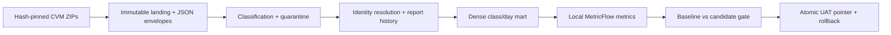

# CVM Fund Analytics

An analytics engineering project that turns Brazilian investment fund disclosures into tested, reproducible metrics.

Built with **dbt v2, DuckDB and local MetricFlow**, `cvm-fund-analytics` demonstrates immutable ingestion, explicit data contracts and a **semantic regression gate that blocks snapshot promotion when metric results change**.

The implemented vertical covers net assets (PL), net cash flow and reporting coverage for **60 Brazilian investment-fund classes, April–September 2026**.

## The central demo: catch a wrong metric before promotion

A net-assets metric is a stock: adding daily balances across a month produces a misleading result. The adversarial demo deliberately removes the metric's semiadditive rule while retaining the underlying data.

| Step | Observed behavior |
|---|---|
| Validate the approved baseline | Frozen PL, flow and coverage oracles pass |
| Remove PL semiadditivity in a candidate | Six monthly results and the overall total change |
| Compare baseline and candidate with MetricFlow | The semantic gate reports the differences |
| Attempt promotion to UAT | Promotion is rejected; the published pointer remains unchanged |

The gate compares **totals, months, class/day values and coverage**, rather than relying only on grand totals. Both snapshots must use the same frozen input contracts. An intentional metric change requires explicit review and a new approved baseline; the gate does not decide business correctness on its own.

See the [recorded mutation result](transform/evidence/ci/linux-acceptance/semantic-mutation.json), [gate contract](specs/ci-uat.md) and [independent review](reviews/ci-uat-review.md).

## Architecture



## Implemented

- Immutable, hash-addressed landing with JSON envelopes, classification and quarantine.
- Explicit identity/grain contracts, report history and a dense class/day mart.
- Business fixtures for duplicates, gaps, identity ambiguity and join fanout; native dbt unit tests and data tests.
- Local MetricFlow metrics for PL, net cash flow and reporting coverage, with frozen real-data oracles.
- Semantic baseline/candidate comparison before UAT promotion; sealed snapshots, independent dev/UAT pointers and rollback.
- dbt documentation and column-lineage acceptance checks.
- Docker-free local development with Make and VS Code. The same Docker-based Linux ARM64 CI runner executes in GitHub Actions; see the [remote run history](https://github.com/danielnrocha/cvm-fund-analytics/actions/workflows/linux-ci.yml).
- A durable baseline package with a versioned Release tag and SHA-256 lock. The [immutable baseline Release](https://github.com/danielnrocha/cvm-fund-analytics/releases/tag/baseline-v1) is public and its asset hash matches the committed lock.

## Roadmap

- Extend the current identity/history models into the full planned Data Vault architecture and additional marts.
- Add returns and holdings analytics after validating the relevant sources and business contracts.
- Build and evaluate an AI BI agent over the semantic layer, using the [planned evaluation scenarios](specs/ai-bi-evals.md).
- Add complete Python distribution hashes and strengthen long-term availability of frozen source archives.

These items are planned work, not implemented capabilities. The [delivery plan](specs/delivery-plan.md) records their scope and acceptance criteria.

## Present the 20–25 minute demo

Use the [presenter runbook](demo/RUNBOOK.md) for real commands and two red/green exercises: missing values incorrectly replaced by zero, and a stock metric incorrectly summed across time. `make demo-prepare` creates a disposable project from a locally verified baseline; `make demo-reset` discards only that marked workspace. `bash demo/rehearse.sh` checks the complete sequence without Docker. Prepare dependencies and the baseline before going offline.

The [demo specification](specs/live-demo.md) separates technical rehearsal evidence from the presenter's spoken rehearsal. It does not require the full Data Vault or an AI agent.

## Run locally

Validated local development platform: macOS ARM64. Requirements: Python 3.12 (or let `uv` provision it), `uv`, and `make`. No cloud warehouse, dbt account, paid semantic service or Docker is required. Initial dependency, driver and input acquisition needs internet.

```sh
make setup       # first installation: separate dbt and MetricFlow environments
make test        # synthetic/business/publication/CI tests; no full CVM download
make build       # verify frozen sources, ingest, full dbt build, real SQL oracles
make metrics     # semantic validation + real MetricFlow oracle queries
make docs        # generate the dbt v2 HTML documentation after the build
```

Open this folder in VS Code and use **Terminal → Run Task → CVM**. Extensions are optional. `make build` updates a development database; it does not promote UAT. Use the [snapshot runbook](specs/snapshot-publication.md) for publication. Serve `transform/target` locally to view docs; this directory contains compiled SQL and internal artifacts and is not automatically published.

The frozen CVM source URLs can change upstream. A changed file fails its checksum check instead of silently changing the demo. See [data attribution and reproducibility](DATA_SOURCES.md).

## Validation and CI

The previous Linux ARM64 offline acceptance passed **70 Python tests + 48 dbt resources** (13 models, 12 native unit tests, 23 data tests), docs, column lineage, semantic comparison, rollback and adversarial mutation. See [recorded results](transform/evidence/ci/linux-acceptance/result.json) and [review](reviews/ci-uat-review.md). Subsequent repository-preparation checks are recorded separately in [the portfolio spec](specs/portfolio.md).

Frozen oracles: PL **BRL 119,385,193,058.06**, net flow **BRL 4,725,910,556.15**, **7,554 reported / 7,560 expected** class/day observations. These are dataset checks, not investment advice or population-wide statistics.

The [Actions workflow](.github/workflows/linux-ci.yml) is active in the [public repository](https://github.com/danielnrocha/cvm-fund-analytics). Consult [remote run results](https://github.com/danielnrocha/cvm-fund-analytics/actions/workflows/linux-ci.yml) for current CI status; historical local acceptance is separate evidence. The baseline is a versioned GitHub Release asset pinned in [baseline.lock.json](ci/baseline.lock.json); expiring Actions artifacts are diagnostic output only.

The repository and baseline are published. The [publication runbook](specs/portfolio.md) documents setup and baseline replacement. No automatic workflow is permitted to overwrite the approved baseline.

## Explore the engineering decisions

| Area | Reference |
|---|---|
| Architecture and scope | [Design](specs/design-proposal.md) |
| Dataset, grain and business rules | [Profiling](specs/cvm-profiling.md) · [Contracts](specs/README.md) |
| Immutable ingestion | [Ingestion contract](specs/ingestion.md) |
| Semantic gate and runtime | [CI/UAT specification](specs/ci-uat.md) |
| Roadmap and remaining work | [Delivery plan](specs/delivery-plan.md) |
| AI BI evaluation design, not a deployed agent | [Evaluation scenarios](specs/ai-bi-evals.md) |

The `compatibility/` directory contains earlier experiments, not the production entrypoint. Python dependencies are version-pinned; complete distribution hashes remain future work. Evidence records have timestamps and apply to the stated revision/scope, not every later edit.

## Repository metadata

GitHub name, description and topics from [repository.json](.github/repository.json) have been applied to the public repository. GitHub does not automatically synchronize subsequent edits to that file.

Protected `main` requires an up-to-date GitHub Actions `validate` check before merge, including administrator changes. A controlled PR proved that offsetting daily metric regressions are rejected even when monthly totals match. See [merge policy and evidence](specs/main-protection.md). Second-person approval is optional for this sole-maintainer portfolio.
