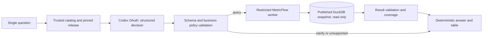

# CVM analytics agent — design contract

As of **2026-11-04**, the deterministic gateway and experimental planner are implemented. Natural-language acceptance remains pending. The CLI serves one local user with read-only access to the published CVM vertical. [Agent evals](ai-agent-evals.md) define acceptance. The [metric contracts](metrics.md) and published semantic manifest define business behavior.

## Decision and explicit exclusions

The runtime uses Python 3.12, Pydantic AI slim, and local MetricFlow. The experimental planner uses the native Pydantic AI Codex provider with application-owned OAuth and no tool registrations. Model choice is provisional until the quality and operational gates pass.

The first scope covers reported PL, net flow and reporting coverage for the fixed 60-class April–September 2026 cohort. Returns, investor counts, holdings, consolidated economic wealth, current market estimates, historical managers, latest-available-per-class PL and time travel through past captures are unsupported.

The official dbt extension remains the dbt development interface. The agent is a separate VS Code terminal program. Compare stays out of the live demo by user decision.

### Subscription-backed inference

The user chose existing Codex subscription/credits via OAuth on 2026-11-04. Inference depends on subscription access, quota and network availability. The deterministic path runs without provider access. Application OAuth is separate from Codex CLI credentials and stays on the local machine. CI exercises controlled outputs and mocked HTTPS transport with no credentials. Wizard trials, API-key billing, local model downloads, local Docker and hosted telemetry are outside the authorized setup. The deployment scope is one trusted local user.

## Reconciliation with the refactored main

Reviewed against main `c884ebc` (PR #3), whose [post-merge CI](https://github.com/danielnrocha/cvm-fund-analytics/actions/runs/40802646918) passed. Fact/semantic source files now live under `transform/models/marts/`; shared native fixtures under `transform/models/intermediate/`; ingestion metadata under `transform/models/staging/cvm/`. Model IDs, grain and PL/flow contracts did not change. Published bundles may retain old paths; inspect their manifests by identity and never combine current source YAML with a different published database.

The [local implementation plan](local-agent-implementation-plan.md) stages deterministic MetricFlow checks before model acceptance. The W01–W12 technical boundary cases remain relevant. Keep the three Python environments isolated and configure `dbt.dbtPath` in VS Code User or Machine settings as documented in CONTRIBUTING.

## Architecture



The model maps language to an intent. Trusted code decides whether and how to execute it. A normal answer needs one model request, at most one validation-repair request, then bounded MetricFlow work to execute the approved intent and verify its SQL. If query execution fails, do not ask the LLM to invent a replacement calculation.

The initial renderer is deterministic. It inserts values, units, dates and coverage from a validated result and selects approved explanatory templates. No second free-text LLM call is required. This sacrifices unrestricted prose to keep numbers and claims grounded. Later narrative generation requires its own grounded-claim evals; adding a nicer chat UI does not require changing this boundary.

## Capability catalog

The serving catalog is the intersection of **published semantic metadata** and a **reviewed application allowlist**. Newly added metrics are not automatically exposed. Fail startup if an allowlisted metric, dimension or definition hash is missing or changed unexpectedly. Keep synonyms in reviewed metadata; never copy financial SQL into the prompt.

Public metrics:

- `reported_net_assets_eop`
- `net_flow`
- `reporting_coverage_eop`
- `reporting_coverage_period`

Supporting counts are automatically queried by the gateway: `reporting_entities_eop`, `expected_entities_eop`, `reporting_observations`, `expected_observations`. They supply coverage denominators, not unique-person counts.

Supported grains: total interval, month, day. Reporting class is the supported non-time grouping. Captured classification is a filter. Classification grouping and multi-dimension groupings remain outside the implemented scope. The catalog must enumerate valid combinations from the pinned manifest/MetricFlow capabilities. Do not assume every Cartesian combination is valid. No arbitrary joins, custom measures, arbitrary aggregation functions, user formulas, metric-value filters or free-text SQL.

Filters: equality or membership on approved class IDs and captured classifications; conjunction only. IDs and values must exist in the frozen cohort. Model-visible names are aliases mapped server-side to exact semantic identifiers. Class names are not currently a supported identifier lookup service. Unknown/ambiguous entities require clarification. Time bounds are validated ISO dates, inclusive as in the installed `mf query` CLI.

Every metric catalog entry includes its unit, source, population, grain, time aggregation, missing policy, coverage measure, supported dimensions, synonyms and counterexamples. The small catalog fits in context; no embeddings are needed.

## Decision contract

The model returns exactly one strict, discriminated structure; unknown fields are rejected:

| Decision | Fields / behavior |
|---|---|
| `query` | Metrics, explicit date range, grain, dimensions, typed filters, requested table/chart kind |
| `clarify` | Reason code and missing slots; application renders a focused question |
| `unsupported` | Capability/reason code and optional supported alternatives |

No SQL, shell command, filename, URI, database path, profile, environment, endpoint, snapshot choice or arbitrary explanatory instructions are accepted as arguments. The application owns these values. There is no model-controlled `confidence` threshold that permits bypassing validation.

Example model intent (design example, not an executed response):

```json
{
  "action": "query",
  "metrics": ["reported_net_assets_eop", "net_flow"],
  "start_date": "2026-04-01",
  "end_date": "2026-09-30",
  "grain": "month",
  "dimensions": [],
  "filters": [],
  "presentation": "table"
}
```

No numeric result is generated by the planner. The validator injects both corresponding coverage pairs, checks the proposed query against the actual catalog, and binds it to the current session release. A repair receives only field-level validation errors, never credentials, stack traces or an expanded capability list. A second invalid plan terminates with `invalid_plan`, not an execution attempt.

## Business policies

1. Missing values remain null. An observed zero remains zero. Never interpolate or carry values forward implicitly.
2. PL uses the common closing date of each bucket. Totals for an interval require a separate semantic total query if needed; never sum monthly/daily PL results to manufacture a total.
3. Flow is reported flow. April, May and August have known gaps. PL closing coverage and flow interval coverage are separate statuses; a response can have complete PL and partial flow.
4. Coverage is a ratio of totals. Query supporting counts under exactly the same population/date filters. Zero denominator means undefined, not 0% or 100%.
5. “Complete” means complete against the frozen reporting calendar, not auditor certification, freshness, absence of cross-investments or a market census.
6. No period supplied: ask for a period. Each invocation starts with no inherited dates or filters. Resolve relative dates against the supplied clock in `America/Sao_Paulo`, not the snapshot maximum.
7. Out-of-snapshot or partly out-of-snapshot ranges receive an explicit unsupported-range response and an available-range alternative. Do not silently clip dates or redefine “last month” as “latest available month”.
8. End-of-period PL on a non-reporting day uses the contracted reporting calendar within the range and displays the effective date. A range with no expected reporting days returns `no_expected_observations`.
9. “How much did they capture?” is ambiguous between gross subscriptions and net flow. Clarify; only net flow is published. “Performance”, “best fund”, or an unspecified “average” also requires clarification or an unavailable-capability answer.
10. If the user asks for causality, financial advice or unsupported derived returns, do not fabricate an explanation from PL/flow. The assistant provides descriptive cohort analytics.

## Gateway and result contracts

Logical operations: `get_catalog()`, `describe_metric(id)`, `query_metrics(intent)` and `explain_query(query_id)`. These are project interfaces, not claims about official dbt MCP tools. The initial planner receives the small catalog directly; the host dispatches the validated query. `explain_query` retrieves the exact recorded SQL for an existing query, not arbitrary SQL supplied by the model.

Resolve the configured UAT pointer **once at session start** with the existing publication verification logic. Pin its immutable bundle, database, semantic manifest, code and hashes for the invocation. Display release ID and date range. A refresh starts a new session explicitly. An in-flight promotion cannot change the pinned data. Do not serve the mutable rehearsal database or current unreviewed source YAML with a published database.

Use the existing `release.uat.collect()` isolation pattern: worker-only temporary project/artifacts, immutable database opened `READ_ONLY`, and fixed MetricFlow executable from `.venv-mf`. Adapt it rather than importing all agent dependencies into the data environment. Hash validation and bundle identity must be part of startup, not a model assertion. Database file permissions alone are insufficient against the owning OS user; the local owner and approved code/bundles are trusted.

The worker renders CLI argument arrays with `shell=False`. Filters come from a small typed AST with enumerated fields/operators, membership-checked values, and tested literal escaping. `--where` being a single argv value does **not** make SQL/Jinja safe. Reject arbitrary expressions before starting the worker. Do not interpolate user text into Jinja templates.

Explain and query must use identical validated arguments, release and semantic manifest. Capture and bind their artifacts to a canonical query hash; the compatibility gate must verify `--explain` behavior in this installed version rather than treating its help text as a guarantee. CSV is parsed using Decimal, never by scraping the formatted terminal table. If the actual output loses cents or the explain/query binding cannot be established, block acceptance and repair the adapter. Do not hide a precision bug with wider tolerances.

Successful result envelope:

- `query_id`, `query_hash`, release/bundle hash, semantic-manifest hash, code revision, engine versions;
- canonical requested intent, actual filters and grain, requested interval and effective cut dates;
- typed rows (money serialized as decimal strings; counts as integers; absence as JSON null);
- units, metric definitions/IDs, per-metric/per-row coverage counts and status;
- raw-result checksum, compiled SQL reference, trusted source references, timing and warnings;
- `status`: `ok`, `partial`, `empty`, or `no_expected_observations`.

Failures return a typed code (`invalid_plan`, `unsupported_capability`, `outside_snapshot`, `too_many_rows`, `snapshot_invalid`, `timeout`, `tool_error`, `result_invalid`) and no numeric answer. Empty output, null and zero are distinct. A provider refusal is not a data result. Paths in internal artifacts are not exposed to external providers or rendered as public source URLs.

## Guardrails and resource budgets

| Boundary | Required enforcement | Acceptance attack |
|---|---|---|
| Model → host | Strict schema, catalog allowlist, bounded decisions | Unknown metric, hidden keys, malformed dates, arbitrary SQL |
| Host → MetricFlow | Fixed executable/cwd/profile, typed filters, no shell | Quotes, Jinja, shell substitution, option/path injection |
| MetricFlow → DuckDB | Read-only published snapshot; no build/run/mutations | Attempt write and verify snapshot hashes unchanged |
| DuckDB → OS/network | Disable external file/network access and extension auto-install/load where compatible; no untrusted SQL or bundles | File-read/remote URL attempt rejected; compatibility gate proves normal queries still work |
| Runtime → providers | Fixed Codex HTTPS endpoints, private OAuth, no redirects, proxies or automatic fallback | Missing credentials fail closed. Mocked transport checks endpoint and tool restrictions |
| Result → answer | Deterministic rendering, required coverage/provenance, no raw HTML | Injected fund/category label never becomes an instruction or executable markup |

DuckDB read-only mode protects database writes, not all file/network operations. Hardening must be applied to the actual worker connections and tested. The trusted local single-user baseline is not a sandbox for hostile arbitrary code or other OS users. Public or multi-user deployment requires a new isolation/authentication design.

The host accepts questions up to 4,096 UTF-8 bytes and makes at most two inference requests per turn. Per request, the client caps the wire response at 512 KiB and accepts up to 8 KiB of structured output and 2,048 reported output tokens, including reported reasoning. Each query supports up to three public metrics, one supported non-time grouping, four filters with up to 20 values each, and 500 result rows. Estimate cardinality from cohort/calendar before querying and also request/check 501 rows to detect overflow. Reject over-limit results rather than silently showing a truncated financial total. No all-dimensions cube or autonomous repeated drill-down.

The CLI starts a shared 60-second monotonic deadline before gateway startup. Worker waits are bounded by the remaining time and capped at 30 seconds per invocation. Late numeric results are rejected. Synchronous startup verification and filesystem operations can delay the timeout response. The deadline is not an OS-enforced wall-clock limit. Worker stdout, stderr and result files are bounded at 2 MiB each. Workers use isolated temp and spill directories, with a DuckDB target memory budget of 2 GiB and two threads, subject to compatibility testing. Termination must kill/reap descendants, not leave an orphan query. Memory settings alone are not a hard OS memory cap. Clean only directories created and owned by that request.

The operational SLO is warm p95 <=15 seconds and cold p95 <=30 seconds. Include startup and snapshot verification in cold timings. A turn that finishes within the request deadline can still miss the latency target. Use bounded local caches only if keyed by release+manifest+policy+canonical intent; do not mix releases or treat cached traces as live model evaluation.

No required tracing backend. Record local structured traces with decision, validation outcome, query ID, timings, versions and hashes. Omit hidden chain-of-thought, credentials and unnecessary question text. The eval prompts are public synthetic data. Keep raw interactive questions out of Git. OAuth inference sends the question and approved catalog. Client output limits do not cap server-side consumption.

## Presentation and interaction

MVP UI: VS Code terminal showing the interpreted plan, validated answer table, coverage and provenance, with the SQL artifact available to inspect. Every invocation is single-turn. Ask a full question with any period and filters. A19-style follow-ups and pending clarification state remain outside the implemented scope and still require qualification before multi-turn support.

Optional chart milestone: deterministic line/bar charts from the same validated table, separate panels for stock and flow, units and partial-period warnings visible, nulls displayed as gaps. No generated Python/JavaScript and no summing chart buckets into stock totals. Chart capability stays off until its tests pass.

## Acceptance and delivery boundary

The [eval contract](ai-agent-evals.md) is normative for this vertical. All deterministic safety/business tests must pass; no critical agent case may fail in three repetitions. Overall held-out action+intent correctness >=95%, but refusals on supported questions cannot inflate the score. Numeric outputs must match independent oracles at their prescribed precision, not merely match another LLM.

The deterministic gateway and bounded OAuth planner precede full evaluation and independent adversarial review. Optional charts have a separate capability gate. CI remains GitHub Actions with Docker on the remote runner only. Per-PR deterministic tests run without network and exercise the sealed candidate through real MetricFlow. Actual model acceptance is a separately recorded run tied to observed provider metadata, exact application and data revisions, and the client environment. Do not present mocked responses as model quality evidence.

The user explicitly authorized implementation through local production on 2026-11-04. Missing benchmark or independent review still means natural-language functionality is **unaccepted**, not production-ready.

## Implementation checkpoint — 2026-11-04

Gateway commit `7d575cb` implements typed intents, immutable bundle verification, coverage injection, read-only constrained MetricFlow execution, Decimal results, actual SQL/explain binding and deterministic rendering. Its 32 checks passed against both the frozen baseline and the post-refactor UAT snapshot. This was the gateway checkpoint. The experimental planner and subsequent review corrections are recorded in the [implementation report](../reviews/agent-planner-implementation.md).

The gateway rejects classification grouping, multiple non-time dimensions and charts pending independent goldens. Historical bundles lacking a source Git revision report it as null and retain verified source fingerprints. The gateway implementation has a separate code hash. The owner can explicitly select a verified durable baseline ID in the CLI configuration. The standard publication mode resolves UAT once.

The installed MetricFlow CLI's automatic update check is suppressed in its fixed local worker entrypoint. Python socket events are denied, and actual DuckDB connections disable external access and extension auto-loading/install. This is not an OS sandbox against the trusted local owner or arbitrary modified native code.

## OAuth transport qualification — 2026-11-04

Codex CLI0.145.0 compatibility probe `a20243f` did not meet the strict no-tools runtime requirement: text-only metadata hid tool declarations but an injected internal plan-update call was still handled. Injected shell/image calls were rejected; this is not evidence of arbitrary file execution. No authenticated canary was run. Use the native Pydantic AI Codex provider with a **fresh, application-owned OAuth session**, never its default shared CLI credential loader. This integration is documented by Pydantic and requires actual compatibility/quality testing; it is not a guarantee of permanent subscription availability or public-service suitability. No credentials belong in GitHub Actions.
