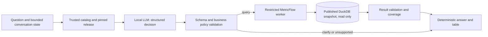

# CVM analytics agent — design contract

Date: **2026-10-28**. Status: **proposed design; no agent implementation or model eval executed**. Scope: a single-user, local, read-only analytics assistant over the published CVM vertical. Recommendation and alternatives: [stack research](ai-agent-research.md). Evaluation contract: [agent evals](ai-agent-evals.md). Business authority: [metric contracts](metrics.md) and the published semantic manifest, never the LLM's memory.

## Decision and explicit exclusions

Use Python 3.12, Pydantic AI slim, local Ollama and Qwen3.5 4B Q4_K_M as the first candidate. Compare 9B only after measuring the 4B candidate. The recommendation is provisional until quality and performance gates pass. No mandatory paid API, hosted telemetry, Docker on the Mac, vector store, RAG pipeline, multi-agent orchestration, SQL-generation fallback or model-driven code execution.

The first release supports facts about reported PL, net flow and reporting coverage for the fixed 60-class April–September 2026 cohort. It does not support returns, investor counts, holdings, consolidated economic wealth, current market estimates, historical managers, latest-available-per-class PL, or time travel through past captures. Those appear in older roadmap evals; they are **unsupported requests** for this release.

The dbt extension remains the development/demo interface for dbt. The agent is a separate program runnable in the VS Code terminal; do not present it as a feature of the official extension or dbt Wizard. Compare stays out of the live demo by user decision.

### Preferred implementation assistant

User preference, reaffirmed **2026-10-28**: **prefer dbt Wizard inside the official VS Code extension wherever feasible**, with Codex supporting specifications, planning, validation and review. This is a development-workflow preference, not a requirement to use Wizard as the analytics runtime. Before the first implementation spike, verify actual account availability, free-use limits and suitability for the planned Python/MetricFlow work. Do not assume that a free extension implies free Wizard usage, or that a trial guarantees ongoing availability. Do not activate billing or change the no-required-paid-service constraint. Keep the deliverable runnable independently of Wizard; use another implementation assistant only where Wizard is unavailable or unsuitable, explaining the concrete limitation. This section is the canonical preference for this project.

Access inspection on **2026-10-28**: the official extension is installed, but authenticated Wizard access and Python/MetricFlow suitability remain unverified. The documented free offer is a limited trial; the local workflow uses Wizard CLI alongside the extension. The user has a domain but no dbt account. See [access evidence and qualification canary](wizard-access.md). Do not present this as an available native chat or completed compatibility test.

## Reconciliation with the refactored main

Reviewed against main `c884ebc` (PR #3), whose [post-merge CI](https://github.com/danielnrocha/cvm-fund-analytics/actions/runs/40802646918) passed. Fact/semantic source files now live under `transform/models/marts/`; shared native fixtures under `transform/models/intermediate/`; ingestion metadata under `transform/models/staging/cvm/`. Model IDs, grain and PL/flow contracts did not change. Published bundles may retain old paths; inspect their manifests by identity and never combine current source YAML with a different published database.

The next step is the [Wizard qualification spike](wizard-agent-spike.md), using Pydantic AI test models with real MetricFlow and a pinned read-only snapshot. It precedes any local-model download or benchmark. Wizard access remains a separate unverified gate. `dbt.dbtPath` is a VS Code User/Machine setting, not a valid workspace pin; follow CONTRIBUTING. Keep all three Python environments isolated.

## Architecture



This is a bounded agentic workflow, not an open-ended tool loop. The model maps language to an intent; trusted code decides whether and how to execute it. A normal answer needs one LLM request, at most one validation-repair request, then at most two MetricFlow invocations (explain and query). If query execution fails, do not ask the LLM to invent a replacement calculation.

The initial renderer is deterministic. It inserts values, units, dates and coverage from a validated result and selects approved explanatory templates. No second free-text LLM call is required. This sacrifices unrestricted prose to keep numbers and claims grounded. Later narrative generation requires its own grounded-claim evals; adding a nicer chat UI does not require changing this boundary.

## Capability catalog

The serving catalog is the intersection of **published semantic metadata** and a **reviewed application allowlist**. Newly added metrics are not automatically exposed. Fail startup if an allowlisted metric, dimension or definition hash is missing or changed unexpectedly. Keep synonyms in reviewed metadata; never copy financial SQL into the prompt.

Public metrics:

- `reported_net_assets_eop`
- `net_flow`
- `reporting_coverage_eop`
- `reporting_coverage_period`

Supporting counts are automatically queried by the gateway: `reporting_entities_eop`, `expected_entities_eop`, `reporting_observations`, `expected_observations`. They supply coverage denominators, not unique-person counts.

Supported grains: total interval, month, day. Dimensions: reporting class and `classification_at_capture`, plus metric time. The catalog must enumerate valid combinations from the pinned manifest/MetricFlow capabilities. Do not assume every Cartesian combination is valid. No arbitrary joins, custom measures, arbitrary aggregation functions, user formulas, metric-value filters or free-text SQL.

Filters: equality or membership on approved class IDs and captured classifications; conjunction only. IDs and values must exist in the frozen cohort. Model-visible names are aliases mapped server-side to exact semantic identifiers. Class names are not currently a supported identifier lookup service. Unknown/ambiguous entities require clarification. Time bounds are validated ISO dates, inclusive as in the installed `mf query` CLI.

Every metric catalog entry includes its unit, source, population, grain, time aggregation, missing policy, coverage measure, supported dimensions, synonyms and counterexamples. The small catalog fits in context; no embeddings are needed.

## Decision contract

The model returns exactly one strict, discriminated structure; unknown fields are rejected:

| Decision | Fields / behavior |
|---|---|
| `query` | Metrics, explicit date range, grain, dimensions, typed filters, requested table/chart kind |
| `clarify` | Reason code and missing slots; application renders a focused question |
| `unsupported` | Capability/reason code and optional supported alternatives |

No SQL, shell command, filename, URI, database path, profile, environment, endpoint, snapshot choice or arbitrary explanatory instructions are accepted as arguments. The application owns these values. There is no model-controlled `confidence` threshold that permits bypassing validation.

Example model intent (design example, not an executed response):

```json
{
  "action": "query",
  "metrics": ["reported_net_assets_eop", "net_flow"],
  "start_date": "2026-04-01",
  "end_date": "2026-09-30",
  "grain": "month",
  "dimensions": [],
  "filters": [],
  "presentation": "table"
}
```

No numeric result is generated by the planner. The validator injects both corresponding coverage pairs, checks the proposed query against the actual catalog, and binds it to the current session release. A repair receives only field-level validation errors, never credentials, stack traces or an expanded capability list. A second invalid plan terminates with `invalid_plan`, not an execution attempt.

## Business policies

1. Missing values remain null. An observed zero remains zero. Never interpolate or carry values forward implicitly.
2. PL uses the common closing date of each bucket. Totals for an interval require a separate semantic total query if needed; never sum monthly/daily PL results to manufacture a total.
3. Flow is reported flow. April, May and August have known gaps. PL closing coverage and flow interval coverage are separate statuses; a response can have complete PL and partial flow.
4. Coverage is a ratio of totals. Query supporting counts under exactly the same population/date filters. Zero denominator means undefined, not 0% or 100%.
5. “Complete” means complete against the frozen reporting calendar, not auditor certification, freshness, absence of cross-investments or a market census.
6. No period supplied: ask for a period, unless the immediately preceding accepted query explicitly supplies it. Display any inherited period/population. Resolve relative dates against the supplied clock in `America/Sao_Paulo`, not the snapshot maximum.
7. Out-of-snapshot or partly out-of-snapshot ranges receive an explicit unsupported-range response and an available-range alternative. Do not silently clip dates or redefine “last month” as “latest available month”.
8. End-of-period PL on a non-reporting day uses the contracted reporting calendar within the range and displays the effective date. A range with no expected reporting days returns `no_expected_observations`.
9. “How much did they capture?” is ambiguous between gross subscriptions and net flow. Clarify; only net flow is published. “Performance”, “best fund”, or an unspecified “average” also requires clarification or an unavailable-capability answer.
10. If the user asks for causality, financial advice or unsupported derived returns, do not fabricate an explanation from PL/flow. The assistant provides descriptive cohort analytics.

## Gateway and result contracts

Logical operations: `get_catalog()`, `describe_metric(id)`, `query_metrics(intent)` and `explain_query(query_id)`. These are project interfaces, not claims about official dbt MCP tools. The initial planner receives the small catalog directly; the host dispatches the validated query. `explain_query` retrieves the exact recorded SQL for an existing query, not arbitrary SQL supplied by the model.

Resolve the configured UAT pointer **once at session start** with the existing publication verification logic. Pin its immutable bundle, database, semantic manifest, code and hashes for all turns. Display release ID and date range. A refresh starts a new session explicitly; an in-flight promotion cannot change the answer's data mid-turn. Do not serve the mutable rehearsal database or current unreviewed source YAML with a published database.

Use the existing `release.uat.collect()` isolation pattern: worker-only temporary project/artifacts, immutable database opened `READ_ONLY`, and fixed MetricFlow executable from `.venv-mf`. Adapt it rather than importing all agent dependencies into the data environment. Hash validation and bundle identity must be part of startup, not a model assertion. Database file permissions alone are insufficient against the owning OS user; the local owner and approved code/bundles are trusted.

The worker renders CLI argument arrays with `shell=False`. Filters come from a small typed AST with enumerated fields/operators, membership-checked values, and tested literal escaping. `--where` being a single argv value does **not** make SQL/Jinja safe. Reject arbitrary expressions before starting the worker. Do not interpolate user text into Jinja templates.

Explain and query must use identical validated arguments, release and semantic manifest. Capture and bind their artifacts to a canonical query hash; the compatibility gate must verify `--explain` behavior in this installed version rather than treating its help text as a guarantee. CSV is parsed using Decimal, never by scraping the formatted terminal table. If the actual output loses cents or the explain/query binding cannot be established, block acceptance and repair the adapter. Do not hide a precision bug with wider tolerances.

Successful result envelope:

- `query_id`, `query_hash`, release/bundle hash, semantic-manifest hash, code revision, engine versions;
- canonical requested intent, actual filters and grain, requested interval and effective cut dates;
- typed rows (money serialized as decimal strings; counts as integers; absence as JSON null);
- units, metric definitions/IDs, per-metric/per-row coverage counts and status;
- raw-result checksum, compiled SQL reference, trusted source references, timing and warnings;
- `status`: `ok`, `partial`, `empty`, or `no_expected_observations`.

Failures return a typed code (`invalid_plan`, `unsupported_capability`, `outside_snapshot`, `too_many_rows`, `snapshot_invalid`, `timeout`, `tool_error`, `result_invalid`) and no numeric answer. Empty output, null and zero are distinct. A provider refusal is not a data result. Paths in internal artifacts are not exposed to external providers or rendered as public source URLs.

## Guardrails and resource budgets

| Boundary | Required enforcement | Acceptance attack |
|---|---|---|
| Model → host | Strict schema, catalog allowlist, bounded decisions | Unknown metric, hidden keys, malformed dates, arbitrary SQL |
| Host → MetricFlow | Fixed executable/cwd/profile, typed filters, no shell | Quotes, Jinja, shell substitution, option/path injection |
| MetricFlow → DuckDB | Read-only published snapshot; no build/run/mutations | Attempt write and verify snapshot hashes unchanged |
| DuckDB → OS/network | Disable external file/network access and extension auto-install/load where compatible; no untrusted SQL or bundles | File-read/remote URL attempt rejected; compatibility gate proves normal queries still work |
| Runtime → providers | Loopback endpoint, approved local model digest, cloud disabled, no automatic fallback | Missing local model fails without a remote request |
| Result → answer | Deterministic rendering, required coverage/provenance, no raw HTML | Injected fund/category label never becomes an instruction or executable markup |

DuckDB read-only mode protects database writes, not all file/network operations. Hardening must be applied to the actual worker connections and tested. The trusted local single-user baseline is not a sandbox for hostile arbitrary code or other OS users. Public or multi-user deployment requires a new isolation/authentication design.

Initial limits (server-owned): question <=4,000 characters; context <=8,192 tokens; at most 2 LLM requests and 512 output tokens per plan; one active question; up to 3 public metrics, 2 non-time dimensions, 4 filters with <=20 values each; <=500 result rows. Estimate cardinality from cohort/calendar before querying and also request/check 501 rows to detect overflow. Reject over-limit results rather than silently showing a truncated financial total. No all-dimensions cube or autonomous repeated drill-down.

Worker budget: 30 seconds per invocation, 60 seconds end-to-end hard deadline, bounded stdout/stderr/result files (2 MiB each), isolated temp/spill directory, DuckDB target memory budget 2 GiB and threads 2, subject to compatibility probe. Termination must kill/reap descendants, not leave an orphan query. Memory settings alone are not a hard OS memory cap. Clean only directories created and owned by that request.

Operational SLO: warm p95 <=15 seconds, cold p95 <=30 seconds. Request deadline and SLO are different: an answer at 40 seconds may respect the hard deadline but fail demo readiness. Use bounded local caches only if keyed by release+manifest+policy+canonical intent; do not mix releases or treat cached traces as live model evaluation.

No required tracing backend. Record local structured traces with decision, validation outcome, query ID, timings, versions and hashes; omit hidden chain-of-thought, credentials and unnecessary question text. Eval prompts are public synthetic data; interactive raw questions are not committed. Remote inference is an explicitly configured future opt-in with minimal catalog/question payload, provider policy review and spend cap.

## Presentation and interaction

MVP UI: VS Code terminal showing the interpreted plan, validated answer table, coverage and provenance, with the SQL artifact available to inspect. Maintain at most the last accepted structured intent and one pending clarification; no unbounded transcript. Follow-up “and by month?” changes grain while preserving displayed filters and dates. A new explicit question cannot inherit hidden filters.

Optional chart milestone: deterministic line/bar charts from the same validated table, separate panels for stock and flow, units and partial-period warnings visible, nulls displayed as gaps. No generated Python/JavaScript and no summing chart buckets into stock totals. Chart capability stays off until its tests pass.

## Acceptance and delivery boundary

The [eval contract](ai-agent-evals.md) is normative for this vertical. All deterministic safety/business tests must pass; no critical agent case may fail in three repetitions. Overall held-out action+intent correctness >=95%, but refusals on supported questions cannot inflate the score. Numeric outputs must match independent oracles at their prescribed precision, not merely match another LLM.

Implement in this order after design review: Wizard access qualification and a deterministic Pydantic AI/MetricFlow spike without a real model; deterministic gateway with TDD; explicitly authorized local-model compatibility/benchmark; bounded planner; full evals and independent adversarial review; presentation UI/optional charts. CI remains GitHub Actions with Docker on the remote runner only. Per-PR deterministic tests require no LLM downloads; actual model acceptance is a separately recorded run tied to exact revisions, artifacts and hardware. Do not present mocked responses as model quality evidence.

No implementation is authorized by a passing design self-review. User requested spec/research/evals first. Missing benchmark or independent review means **proposed**, not production-ready.
