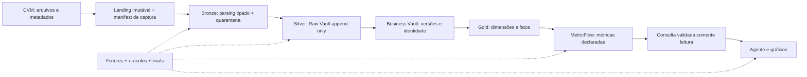
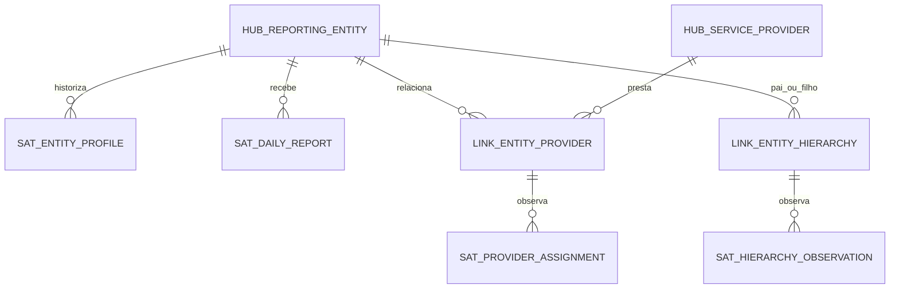

# Design proposto — Fund Analytics com dbt

> Stack aprovada pelo usuário em 28/10/2026: **dbt v2 + DuckDB + MetricFlow local**, sem serviços pagos obrigatórios. A vertical CVM e sua governança estão implementadas; a arquitetura completa continua parcialmente planejada. Evidências e limites: [compatibilidade](compatibility.md) e [editor, linhagem e JSON](compatibility-extended.md).

Estado: stack e recorte real validados; consultar [demo prática](live-demo.md) para o escopo executável atual. A arquitetura ampliada abaixo permanece proposta. Autoridade: requisitos do usuário e evidências de [research-review.md](research-review.md). Nomes de modelos abaixo são contratos propostos, não tabelas já existentes.

## Objetivo e escopo

Construir uma referência didática avançada que demonstre como transformar dados públicos revisáveis em respostas analíticas verificáveis. A demo precisa tornar visíveis os erros que um SQL aparentemente plausível cometeria e como contratos, histórico, testes e semântica os impedem.

O produto é uma pipeline local reproduzível e uma interface semântica para um agente de BI. “Production-grade” significa aqui disciplina de engenharia, promoção e recuperação testadas; não alta disponibilidade, operação 24×7 ou infraestrutura distribuída.

| ID | Requisito | Evidência de aceitação |
|---|---|---|
| R1 | dbt v2 + DuckDB + MetricFlow local, VS Code, sem serviço pago obrigatório | Setup documentado e fixtures funcionam localmente; execuções de palco sem rede |
| R2 | Fonte real e linhagem | Métrica aponta a modelo, revisão e arquivo com checksum |
| R3 | Semiestruturado honesto | Originais preservados; JSON nativo e envelope derivado identificados |
| R4 | Data Vault pequeno com histórico | Reprocessamento não duplica; correção não apaga versão anterior |
| R5 | Star schema com grãos explícitos | Unicidade, joins e temporalidade provados por testes |
| R6 | Métricas governadas | AUM, fluxos e cobertura passam oráculos independentes |
| R7 | TDD e revisão adversarial | Falha intencional observada, correção e revisão independente registrada |
| R8 | Dev/CI/UAT/prod-demo | Isolamento e promoção do mesmo candidato demonstrados |
| R9 | AI BI verificável | Eval set cobre erros numéricos, ambiguidades e recusas |
| R10 | Demo resiliente | Roteiro funciona com dados locais e saída de fallback identificada |

Não objetivos: recomendar investimentos, deduzir investidores únicos, reconstruir carteiras confidenciais, estimar exposição econômica consolidada de fundos de fundos, fabricar histórico anterior à captura, implementar catálogo empresarial ou servidor multiusuário.

## Alternativas de arquitetura

1. **Aprovada: dbt v2 + DuckDB + Vault pequeno + estrela + MetricFlow.** Equilibra os objetivos didáticos com execução local. Custo: manter poucos padrões DV próprios, cuja correção deve ser testada.
2. **Alternativa de modelagem na stack aprovada: dbt v2 + DuckDB + staging histórico + estrela + MetricFlow.** Melhor custo/benefício para um projeto real com uma fonte e poucos consumidores. Perde a demonstração explícita de hubs/links/satélites.
3. **Postgres local + Core + package DV compatível + MetricFlow.** Evita parte das macros próprias, mas adiciona serviço/containers e reduz a simplicidade de leitura local dos arquivos. Não há benefício suficiente para torná-lo baseline desta demo.

Medallion descreve progressão de qualidade; Data Vault e dimensional são técnicas de modelagem. Não há obrigação de chamar Raw Vault de bronze nem de espalhar DV por todas as camadas.

## Stack e experiência de desenvolvimento aprovadas

- Transformação: dbt **2.0.9**; DuckDB embutido reportado **1.5.4**. Instalação isolada `.venv-dbt` e caminhos explícitos nas tarefas.
- Semântica: `dbt-metricflow` **0.15.0**, MetricFlow **0.213.0**, `dbt-duckdb` **1.11.1**, DuckDB Python **2.0.0**, em `.venv-mf`. O pacote inclui Core **1.12.6** e o usa para carregar configurações/conexões; o manifesto e os modelos são produzidos pelo v2.
- Python **3.12**; locks separados. Não instalar ambos os executáveis dbt no mesmo ambiente. Writer único; consultas após terminar a transformação. Driver de docs Darwin-arm64 fixado em `docs-driver.lock.json`; usar wrapper que verifica hash e recusa fallback. Outras plataformas exigem lock e prova próprios.
- Nova sintaxe semântica junto aos modelos; `mf validate-configs` é obrigatório em CI/UAT. Não usar `dbt sl` ou endpoint hospedado para a baseline.
- VS Code executa tarefas com binários explícitos. A extensão oficial 0.122.0 iniciou e a tarefa de build passou no VS Code 1.143.1, mas o teste de coluna inexistente não produziu diagnóstico SQL na janela observada; não tornar login, LSP ou painel de linhagem pré-requisito para executar o projeto.
- Linhagem de colunas: `dbt compile --static-analysis strict --generate-info-schema`, seguido do wrapper `pinned_docs.py` (executa `dbt docs generate --no-compile` com driver verificado). O flag de análise estrita pertence a compile/build; passá-lo diretamente a docs falhou no 2.0.9. Conferir arestas esperadas no Parquet, não apenas a existência do arquivo.
- Arquivos JSON: transporte para landing física com payload original, checksum e linha; parsing e classificação de rejeições em SQL dbt. A leitura direta com `read_json(..., format=..., columns=...)` funcionou em runtime, mas falhou na análise estrita. Não desligar análise globalmente para contornar isso.
- Aresta `payload → revenue` é linhagem de coluna, não prova automática do JSONPath interno. Documentar o caminho no contrato de extração e preservar a origem do arquivo separadamente.

## Fontes, recorte e contratos de ingestão

Começar com cadastro e informe diário. CDA entra como segunda entrega vertical, primeiro com blocos identificáveis e posições consolidadas confidenciais; demais blocos somente após seu grão ser entendido. Não anunciar cobertura de oito blocos quando apenas dois foram implementados.

O recorte real foi definido pelo [profiling CVM](cvm-profiling.md): **60 classes, abril–setembro/2026, 7.554 observações**; 20 de cada classificação atual (Ações, Multimercado, Renda Fixa). Classes sem subclasses, um único pai cadastral e uma classe por fundo; lista congelada por SHA-256 do CNPJ. Seis lacunas reais permanecem. Universo, calendário, arquivos e hashes estão versionáveis em `profiling/cvm/evidence/`. A amostra é didática, com viés de continuidade; não representa a indústria. Alterações cadastrais históricas e carteira incompleta não foram provadas por esta captura; permanecem cenários futuros/sintéticos.

Separar:

- `source_manifest`: recurso, URL, checksum, tamanho, versão do schema, licença, data de captura, intervalo coberto e resultado da extração.
- `raw_observation`: arquivo, linha/caminho JSON, conteúdo original, data de observação e identificador estável dessa observação.
- `business_key`: identidade de negócio, incluindo tipo de entidade e sistema de identificação.
- `payload_hash`: hash somente de atributos relevantes, sem `_extracted_at` ou `_batch_id`.

Recaptura idêntica pode gerar novo evento operacional de extração, mas não nova alteração de negócio. A mesma linha em arquivos diferentes não é automaticamente uma nova posição financeira. Revisão real só existe quando observada; revisão sintética permanece na fixture e jamais é incorporada à série real.

Python faz transporte, descompactação, checksums e catalogação. Regras financeiras, padronização analítica, resolução de versões e agregações ficam em dbt SQL. Configurações e políticas são declarativas, mas extração e execução exigem algum código; “tudo declarativo” não deve esconder lógica imperativa em macros gigantes.

## Bronze: preservar evidência

Registrar relações físicas de landing com coluna JSON/payload e proveniência, em vez de presumir que qualquer expressão `read_json()` se comporta como source em freshness, catálogo e unit tests. Alternativa de source externo do adapter só passa a ser padrão após o smoke test comprovar essas interfaces.

Modelos `stg_cvm__registry_observations`, `stg_cvm__daily_observations` e `stg_cvm__holding_observations` fazem cast e parsing. Usar schema explícito, preservar campos inesperados no payload, tratar null/vazio/arrays vazios sem inventar valores. Erros de parsing entram em quarentena com reason code e contagem; falha de contrato crítico bloqueia promoção.

Somente staging lê `source()`. Regras de qualidade não devem remover silenciosamente valores extremos. Decimal financeiro preserva precisão de origem; casts overflow/falhos são explícitos. A data de competência é DATE; timestamps técnicos são UTC. O calendário de reporte brasileiro é uma dimensão distinta da data de ingestão.

## Silver: Data Vault delimitado

Modelo inicial proposto:

`hub_reporting_entity` distingue fundo, classe e subclasse por namespace e chave hierárquica; não funde CNPJs diferentes nem considera `ID_SUBCLASSE` global sem evidência. `hub_service_provider` representa gestor/administrador identificáveis; o link preserva o papel. As chaves e regras de resolução para a primeira vertical estão em [data-contracts.md](data-contracts.md); casos fora da coorte permanecem não homologados.

`sat_daily_report`: entidade reportante × competência × versão observada. Não comparar o payload apenas com a última linha de toda a entidade: duas datas podem legitimamente ter os mesmos valores. Preservar a sequência A→B→A de uma correção; eliminar globalmente por hashdiff apagaria a terceira observação. A regra de idempotência usa identidade da observação e transições por chave/período.

Raw Vault usa append idempotente e writer único. Todo registro inclui chave, load time e record source. Intervalos finais são derivados por janela; o Raw Vault não precisa receber updates para encerrar registros. Não introduzir effectivity satellite genérico sem provar a semântica da relação e seu driving key. Multi-active satellite só se houver múltiplos valores simultâneos reais e chave de discriminação estável.

Guardar dois eixos temporais: competência/vigência de negócio quando conhecida e instante em que observamos a informação. Se só existe cadastro atual, podemos afirmar “observado desde X”, não “vigente desde X”. Dado tardio pode exigir reconstruir dimensões e fatos afetados. Um `max(report_date)` não é watermark suficiente para detectar correções antigas.

Hashing: serialização canônica com ordem fixa, tipos, comprimento/escape e null explícito; teste de separadores, Unicode, leading zeros, vazio e null. Normalizar nomes para busca não implica normalizá-los para identidade. Detectar uma mesma hash key associada a chaves naturais diferentes. Algoritmo, codificação e versão do contrato de hash ficam em ADR.

CDA acrescenta relações entidade–posição e, quando identificável, posição–instrumento. Não criar um `hub_asset` universal por nome. Posição opaca continua válida como observação, sem fabricar ativo.

## Business Vault e marts

Business Vault resolve a versão válida para um `as_of` de conhecimento, normaliza identidade e estabelece regras de comparabilidade. Uma visão “última verdade conhecida” é distinta de “o que sabíamos em determinada captura”. PIT só entra se reduzir complexidade demonstrável; bridge só para relação multivalorada real, com política de atribuição.

| Modelo proposto | Grão | Cuidados |
|---|---|---|
| `dim_reporting_entity` | Uma versão de perfil por entidade | SCD2 com intervalos [início,fim), sem overlaps; tempo conhecido explicitado |
| `dim_service_provider` | Prestador identificável | Papel atribuído na relação, não inferido do nome |
| `dim_date` | Dia | Competência e calendário de reporte |
| `dim_instrument` | Instrumento resolvido por namespace | Unknown não é instrumento real |
| `fct_entity_daily` | Entidade reportante × dia na versão selecionada | Classe resolvida × dia, limitada à coorte validada |
| `fct_portfolio_position` | Entidade × competência × bloco × posição consolidada vigente | Revisões removidas da visão corrente, preservadas no Vault |
| `fct_portfolio_coverage` | Entidade × competência | Valores divulgados, confidenciais e discrepância de reconciliação |

Preferir estrela a snowflake para facilitar navegação e joins do agente. Dimensão SCD2 não deve ser associada pelo CNPJ sozinho: resolver surrogate key e vigência na construção da fato. Expor ao modelo semântico relações muitas-para-uma comprovadas. Denormalizar atributos estáveis de análise na interface semântica quando isso evitar um join temporal ambíguo.

Fatos diários e mensais não se juntam linha a linha. Comparações entre PL e carteira passam por agregação em grão compatível, com competência e perímetro alinhados. Não prometer identidade exata entre valor de carteira e patrimônio líquido, que são medidas diferentes.

## Contratos de métricas

O contrato normativo v1 está em [metrics.md](metrics.md), com oráculos reais. A lista abaixo é roadmap: retornos e CDA permanecem não publicados; somente PL, fluxo, contagens reportadas e cobertura compõem a primeira vertical.

Cada métrica declara nome, definição, unidade, população elegível, grão nativo, dimensões permitidas, operação no tempo, operação entre entidades, política de missing, calendário, versão, owner e exemplos positivos/negativos.

| Métrica | Regra proposta |
|---|---|
| `reported_net_assets_eop` | Soma do PL de entidades elegíveis em uma data comum de fechamento; não somar dias |
| `reported_net_assets_latest_available` | Último PL disponível por entidade dentro do limite de defasagem; devolver datas/coverage, nome distinto |
| `net_flow` | Soma de captações menos resgates no intervalo; ausência não equivale a zero |
| `reported_investor_accounts_eop` | Soma dos números reportados na data elegível; nunca chamar de investidores únicos |
| `quota_return_period` | Quota final / inicial − 1, somente série comparável e tratamento de eventos definido |
| `equal_weight_mean_daily_return` | Média explicitamente não ponderada das entidades elegíveis por dia; não retorno de investimento |
| `disclosed_top10_concentration` | Top 10 instrumentos identificáveis por entidade/mês dividido por valor divulgado elegível |
| `portfolio_disclosure_coverage` | Parcela divulgada do total reconciliável definido; sem denominador válido, null + motivo |

A soma de PL de fundos que investem em outros fundos pode representar dupla contagem econômica. Nomear a métrica como patrimônio reportado bruto da coorte. Não chamá-la de riqueza única ou exposição consolidada do mercado.

Não somar PL de classe e suas subclasses se a fonte repetir a mesma medida. O contrato de elegibilidade deve estabelecer quais linhas formam uma partição econômica disjunta. Se essa relação não puder ser comprovada, limitar a primeira demo a uma população com grão inequívoco e explicar a restrição.

No fechamento mensal, um `max(report_date)` global e um último dia por entidade produzem números distintos quando há atraso. Demonstrar ambos com nomes e políticas diferentes. O calendário de referência não será inferido silenciosamente do maior dia encontrado.

Top10 é contexto-dependente: não somar nem tirar média indiscriminada entre fundos ou meses. Para uma concentração consolidada, seria necessário recompor posições no universo solicitado e refazer ranking. Essa consulta fica fora do MVP. Nem toda pergunta precisa virar uma métrica nativa: usar cálculo previamente modelado com restrição de grão é preferível a prometer agregação arbitrária.

`non_additive_dimension` foi validado com `window_agg: max` e `group_by: []` ou `[account]`, na nova sintaxe YAML. É mecanismo de execução, não substituto dessas definições. Uma consulta sem observações retorna null; max observado não comprova fechamento oficial ou completude. Métrica sem garantia no engine recebe materialização de suporte ou é recusada até passar no oráculo.

## Interface de AI BI

Fluxo: pergunta → intenção estruturada → validação contra catálogo → plano semântico → SQL compilado → execução read-only → resultado com evidências → gráfico/narrativa.

Proposta mínima de ferramentas: `list_metrics`, `describe_metric`, `list_dimensions`, `query_metrics`, `explain_query`. São contratos do projeto, não promessa de que o MCP oficial os implementa localmente. O backend deve reutilizar MetricFlow; evitar construir outro compilador de métricas.

Entrada validada: métricas, dimensões, filtros tipados, intervalo, granularidade, política temporal e limite. Saída: valores, unidade, query/SQL, data snapshot, versão das métricas, cobertura, warnings e proveniência. Nada de SQL livre como fallback automático. Tool calls usam argumentos estruturados, timeout e limite de linhas; não shell concatenado. Payloads descritivos da fonte são dados, nunca instruções para o agente.

Uma camada semântica reduz classes de erro, mas não garante “zero alucinação”. O agente ainda pode interpretar mal a pergunta ou narrar uma conclusão falsa. Regras de resposta e evals precisam avaliar essas etapas separadamente. Pergunta ambígua pede esclarecimento; pergunta impossível recebe recusa explicada.

Cubos: começar com agregação sob demanda. Materializar apenas combinações usadas e caras após medir. Para médias e taxas, armazenar componentes aditivos (soma e contagem/numerador e denominador), nunca apenas média de médias. Distinct count, retornos e percentis não têm rollup aditivo geral. Não adicionar Cube, OLAP server ou vector DB no baseline.

## Ambientes e entrega

Um engine, mesma lógica, configurações de ambiente. Cada dev/CI ganha banco próprio; UAT e prod-demo usam snapshots de release. Schema names sozinhos não isolam arquivos, conexões, credenciais ou caminhos de input.

O CI obrigatório constrói toda a fixture do zero, executa uma segunda ingestão, uma correção tardia e compara incremental com rebuild. Slim CI é demonstração complementar: baseline físico pequeno, manifest correspondente, attach read-only e isolamento provado. Sem baseline físico, full fixture build. Nunca usar `--state target/` enquanto o comando sobrescreve esse target.

Mudanças em métricas disparam validação/queries/evals mesmo quando nenhum SQL muda. Mudanças em macros globais, grão, source contract ou dependências podem exigir build completo.

UAT compara código antigo e candidato **sobre o mesmo snapshot de entrada**; separa mudança de código de mudança da fonte. Usa critérios de negócio, revisão de deltas e aceite humano. Promover o mesmo SHA, lockfile e artefato testado. Tag que aponta outro SHA não herda aceite.

Release bundle: banco fechado e consistente, manifest dbt, semantic manifest, resultados, dicionário de métricas, checksums e versões. Promover por troca de ponteiro para versão imutável; rollback retorna bundle anterior. Writer único; clientes leem snapshot publicado, sem disputar o arquivo de build. Não reconstruir silenciosamente com novos dados depois do aceite.

Freshness tem dois indicadores: tempo desde a captura bem-sucedida e completude de competências esperadas. Recapturar arquivo antigo não torna dado atual. Prod-demo verifica freshness antes de publicar e mantém release anterior se um teste bloqueante falhar. SLO alvo de D+2 dias úteis é política de demonstração a calibrar; não garantia da CVM.

## ADRs propostos

| ADR | Decisão | Consequência |
|---|---|---|
| 001 — aceito | dbt v2 2.0.9 + DuckDB + MetricFlow local | Dois ambientes; Core 1.12.6 permanece dependência interna do mf, não motor de transformação |
| 002 | CVM direta; BD como catálogo | Sem custo de acesso tratado, mais responsabilidade de parsing |
| 003 | Vault mínimo; SQL explícito antes de macros genéricas | Legibilidade e revisão melhores; menor automação inicial |
| 004 | Raw Vault append-only; derivados podem ser reconstruídos | Auditoria preservada e backfill explícito |
| 005 | Estrela com identidade/tempo resolvidos antes da semântica | Menos joins perigosos no consumo |
| 006 | Full fixture CI obrigatório; Slim CI complementar | Correção não depende de artefatos remotos disponíveis |
| 007 | MetricFlow local + interface restrita | Sem endpoint hospedado; pequena integração própria |
| 008 | Snapshot fixo no palco | Reprodutibilidade; ingestão atual é comando separado |
| 009 | Wizard opcional | Sem bloqueio por trial, conta ou créditos |
| 010 | Packages adicionados por necessidade | Começar com dbt_utils; evaluator/audit_helper após prova; demais opcionais |

## Gates que impedem uma promessa falsa

G0: dois ambientes isolados e interoperáveis com versões fixadas. Build v2, consultas mf, incremental, JSON externo via landing física e docs com linhagem foram comprovados. Unit test nativo com mutação, contrato de tabela e métricas semiaditivas passaram nos [gates finais](compatibility-final-gates.md); não confundir probes sintéticos com homologação de domínio. G1: grão e sample definidos por dados reais — concluído para a coorte limitada em [cvm-profiling.md](cvm-profiling.md). G2: temporalidade e idempotência demonstradas. G3: resultados semânticos batem com oráculos. G4: promoção/rollback e ensaio aprovados. O plano descreve como produzir essas evidências; esta revisão não afirma que já existem.

## Validação isolada dos contratos de negócio

[Fixtures de negócio](business-fixtures.md) comprovam duplicatas, lacunas, identidade e fanout em laboratório. A revisão adversarial ampliou a precisão de fluxo derivado para DECIMAL(38,2). A→B→A em memória não fecha G2 de persistência/idempotência, e agregação DuckDB não fecha G3 de MetricFlow. Essas provas serão portadas para os modelos efetivos.

## Estado após primeira vertical

A [primeira vertical mínima](first-vertical.md) está implementada e revisada: seeds do snapshot congelado, resolução, satélite incremental e mart denso. Esta é uma redução explícita do design completo: hubs/links, source JSON e SCD2 de cadastro não foram antecipados. G2/G3 têm evidência para os cenários delimitados de captura, replay, rebuild e PL/fluxo/cobertura; não constituem aceite de toda a arquitetura.

## Atualização: ingestão por sources

A [ingestão CVM](ingestion.md) substitui os seeds descritos anteriormente: ZIPs preservados por SHA-256, envelopes JSON, sources físicos, quarentena e reconciliação por arquivo. População/calendário permanecem contratos congelados. Oráculos e histórico mínimo foram preservados; consulte o documento para escopo e evidências atuais.

## Atualização: publicação de snapshots — 28/10/2026

A [publicação atômica local](snapshot-publication.md) implementa bundles verificados, ponteiros independentes dev/UAT, rollback e leitores read-only fixados na release. Substitui referências anteriores a promoção local pendente. O aceite CI Linux posterior consta na seção CI/UAT abaixo; a pipeline completa permanece fora deste escopo. PL e fluxo permanecem reconciliados com os mesmos seis oráculos reais.

## Gate semântico de promoção UAT

A [spec CI/UAT](ci-uat.md) implementa a comparação por múltiplos grãos antes da promoção, com inputs e bundles vinculados ao relatório e CAS. O runner Linux ARM64 passou offline em container local, incluindo docs, oráculos, comparação semântica e mutação adversarial. O workflow remoto está ativado em `danielnrocha/cvm-fund-analytics`; resultados atuais e baseline imutável estão vinculados no [runbook de portfólio](portfolio.md).

Decisão de execução: CI canônico em GitHub Actions com Docker remoto; desenvolvimento nativo sem Docker. Baseline aprovado em Release versionada com hash, sem dependência da retenção de artefatos de run. [Contrato de portfólio](portfolio.md).
